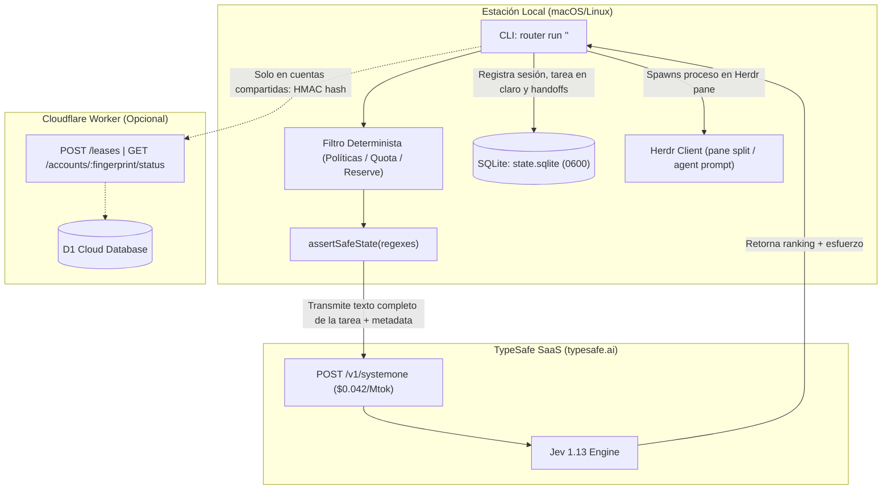

# SCOUT Assessment — Agent Router (`nidhi-singh02/agent-router`)

**Fecha de evaluación:** 2026-10-09T21:20:00-06:00 (2026-10-10 UTC)  
**Rol del evaluador:** Scout (Gemini 3.8 Flash High)  
**Objetivo:** Inventario verificable de fuentes primarias, contraste riguroso entre documentación/claims y código implementado, y mapeo de flujos de datos. Evaluación técnica previa; **NO incluye síntesis de decisión, plan de implementación ni cambios de código**.

---

## 1. Identificación del Objeto de Estudio y Estado del Repositorio

- **Directorio de análisis local:** `/Users/wiseconnex/Documents/projects/agent-router` (clon de trabajo limpio en rama `main`).
- **Upstream canónico:** [https://github.com/nidhi-singh02/agent-router](https://github.com/nidhi-singh02/agent-router).
- **Commit analizado (HEAD):** [`fb24d06a62fb33a92c7836b4920ae9f4b1216c63`](https://github.com/nidhi-singh02/agent-router/commit/fb24d06a62fb33a92c7836b4920ae9f4b1216c63) (*Merge pull request #37 from nidhi-singh02/feat/live-effort-switch*).
- **Fork preexistente:** [https://github.com/wiseconnex/agent-router](https://github.com/wiseconnex/agent-router) (creado con anterioridad a la instrucción de evaluación; **sin adopción aceptada**).
- **Métricas de código verificadas por comando:**
  - `packages/router/src`: 89 archivos TypeScript, 7.275 líneas de código (LOC).
  - `packages/router/test`: 63 archivos TypeScript de prueba, 10.025 líneas de código.
  - `packages/coordinator`: 7 archivos TypeScript (src + test), 615 líneas de código.
  - `packages/hermes-heartbeat`: 6 archivos TypeScript (src + test), 308 líneas de código.
  - Total monorepo TypeScript en `packages/`: 102 archivos fuente, 18.223 líneas totales (fuente + pruebas).

---

## 2. Inventario de Fuentes Primarias y Estado HTTP

| Recurso / URL | Tipo | HTTP Status | Fecha Acceso | Claim Principal / Función | Implicación de Seguridad / Arquitectura |
| :--- | :--- | :---: | :---: | :--- | :--- |
| `https://api.github.com/repos/nidhi-singh02/agent-router` | GitHub REST API | `200 OK` | 2026-10-10 | Repositorio público, 112 estrellas, 13 forks, 2 PRs abiertos (#35, #36). Creado 2026-09-17, último push 2026-09-27. Licencia MIT. | Código abierto reciente (~3 semanas de vida), autoría unipersonal principal (`nidhi-singh02`). |
| [README.md](https://github.com/nidhi-singh02/agent-router/blob/fb24d06a62fb33a92c7836b4920ae9f4b1216c63/README.md) | Repo Documentación | `Local (200)` | 2026-10-10 | "Local-first, quota-aware routing for AI coding agents in Herdr... picks Cursor, Claude Code, Codex, or OpenCode". | Presenta el software como local-first y quota-aware; omite en el resumen inicial que dry-run requiere API key externa. |
| [docs/privacy.md](https://github.com/nidhi-singh02/agent-router/blob/fb24d06a62fb33a92c7836b4920ae9f4b1216c63/docs/privacy.md) | Repo Documentación | `Local (200)` | 2026-10-10 | Especifica exclusión de credenciales hacia TypeSafe, permisos locales 0700/0600 y HMAC para coordinator. | Advierte explícitamente: "arbitrary sensitive narrative text still remains the caller's responsibility". |
| [docs/configuration.md](https://github.com/nidhi-singh02/agent-router/blob/fb24d06a62fb33a92c7836b4920ae9f4b1216c63/docs/configuration.md) | Repo Documentación | `Local (200)` | 2026-10-10 | Esquema de cuentas, reserva mínima del 40% en compartidas, almacenamiento en macOS Keychain. | Recomienda guardar la API key de TypeSafe en Keychain de macOS (`keychain:model-router-typesafe`). |
| [docs/operations.md](https://github.com/nidhi-singh02/agent-router/blob/fb24d06a62fb33a92c7836b4920ae9f4b1216c63/docs/operations.md) | Repo Documentación | `Local (200)` | 2026-10-10 | Guía operativa de worktrees, live effort locks, coordinator D1 y dry-runs. | Confirma que `--dry-run` sin TypeSafe key falla con `typesafe-unavailable`. |
| [docs/provider-support.md](https://github.com/nidhi-singh02/agent-router/blob/fb24d06a62fb33a92c7836b4920ae9f4b1216c63/docs/provider-support.md) | Repo Documentación | `Local (200)` | 2026-10-10 | Matriz de soporte de agentes CLI (Cursor, Claude Code, Codex, OpenCode). | Confirma que los recolectores de CLI son fixtures o statuslines, no APIs directas funcionales del proveedor. |
| [docs/repo-map.md](https://github.com/nidhi-singh02/agent-router/blob/fb24d06a62fb33a92c7836b4920ae9f4b1216c63/docs/repo-map.md) | Repo Documentación | `Local (200)` | 2026-10-10 | Mapeo arquitectónico de 7.3k LOC. Hotspots identificados: `commands/run.ts` (859 LOC), `semantic/decision-engine.ts`. | Documenta explícitamente: "semantic/decision-engine (237): hard dependency on TypeSafe; no offline fallback". |
| `https://docs.typesafe.ai/llms.txt` | Vendor Documentación | `200 OK` | 2026-10-10 | Índice oficial de documentación de TypeSafe AI y primitivas de System One. | Documenta la arquitectura de System One (Jev) para evaluación de preguntas tipadas (`Choice`, `Score`, `Noul`). |
| `https://docs.typesafe.ai/models.md` | Vendor Documentación | `200 OK` | 2026-10-10 | Catálogo del modelo Jev 1.13 (`jev-1.13.0`). Precio: **$42/Btok ($0.042/Mtok)**. | **Servicio de pago**. No es un servicio gratuito ni una biblioteca local; factura por tokens de entrada. |
| `https://docs.typesafe.ai/api.md` | Vendor Documentación | `200 OK` | 2026-10-10 | Especificación del endpoint `POST https://api.typesafe.ai/v1/systemone`. | Requiere cabecera `Authorization: Bearer <API_KEY>`. Contexto máximo 64k tokens. |
| `https://api.typesafe.ai/v1/systemone` | External API Endpoint | `405 Method Not Allowed` (GET/HEAD) | 2026-10-10 | Endpoint activo en producción (Cloudflare), cabecera `allow: POST`, emite `x-typesafe-request-id`. | Punto final hacia donde el router despacha cada tarea textual analizada. |
| `https://skillsllm.com` (escaneo de terceros) | External Security Scan | `200 OK` | 2026-10-10 | Escaneo heurístico automatizado de dependencias y prompt-injection sin hallazgos críticos. | Descargo explícito: "Does not constitute a formal security certification". No equivale a auditoría profesional. |
| `/Users/wiseconnex/.hermes/skills/odd-protocol/SKILL.md` | ODD Protocol Specification | `Local (200)` | 2026-10-10 | Especificación v1.6.0 de Organic Driven Development (ODD). | ODD es guía conductual de proporcionalidad ("lo pequeño se queda pequeño"), no una whitelist rígida ni un router de procesos. |
| `/Users/wiseconnex/.hermes/skills/odd-protocol/scripts/odd-classify.py` | ODD Internal Script | `Local (200)` | 2026-10-10 | Clasificador heurístico local (<1ms) con intento previo a shim HTTP local (`localhost:8077`). | Demuestra que el clasificador ODD interno sí posee fallback determinista local real ante fallos del backend. |

---

## 3. Contraste Sistemático: Propaganda de Marketing vs. Realidad en Código

### 3.1. Reclamo "Local-First" vs. Dependencia Obligatoria en la Nube
- **El Reclamo (README.md:27-28):**  
  *"Local-first: configuration, usage snapshots, decisions, and session history stay on your machine unless an explicitly configured integration needs them."*
- **La Realidad en el Código:**  
  1. **Dependencia dura de red:** [`packages/router/src/semantic/decision-engine.ts#L91-L200`](https://github.com/nidhi-singh02/agent-router/blob/fb24d06a62fb33a92c7836b4920ae9f4b1216c63/packages/router/src/semantic/decision-engine.ts#L91-L200) ejecuta hasta **tres llamadas HTTP POST consecutivas** a la API de TypeSafe (`client.systemOne`) para cada ruteo:
     - Llamada 1: Clasificación de familia, fase, complejidad, creatividad, consecuencia y valor de caché.
     - Llamada 2: Reranking y ponderación probabilística entre candidatos elegibles.
     - Llamada 3: Selección del nivel de esfuerzo (`ReasoningEffort`).
  2. **Código muerto en fallback:** En [`packages/router/src/semantic/fallback.ts#L5-L24`](https://github.com/nidhi-singh02/agent-router/blob/fb24d06a62fb33a92c7836b4920ae9f4b1216c63/packages/router/src/semantic/fallback.ts#L5-L24) existe una función `deterministicFallback()`. Sin embargo, en el orquestador principal [`packages/router/src/commands/run.ts#L364-L375`](https://github.com/nidhi-singh02/agent-router/blob/fb24d06a62fb33a92c7836b4920ae9f4b1216c63/packages/router/src/commands/run.ts#L364-L375), el código aborta directamente si `decision.status !== "selected"`:
     ```ts
     if (decision.status !== "selected") {
       return {
         code: 2,
         output: [
           `TypeSafe could not select a route (${decision.status}).`,
           decision.status === "typesafe-unavailable" ? deps.typesafeKeyHint : undefined,
         ].filter(Boolean).join(" "),
         json: { ok: false, status: decision.status },
       };
     }
     ```
     El fallback determinista **nunca se ejecuta**. Sin conexión a TypeSafe o sin API key válida, el router no toma ninguna decisión local y finaliza con código de error 2.
  3. **Dry-Run no es offline:** En [`packages/router/src/commands/run.ts#L329`](https://github.com/nidhi-singh02/agent-router/blob/fb24d06a62fb33a92c7836b4920ae9f4b1216c63/packages/router/src/commands/run.ts#L329), `decideRoute()` se invoca **antes** de evaluar el flag `options.dryRun` (línea 405). Por lo tanto, ejecutar `router run "tarea" --dry-run` transmite el texto íntegro a TypeSafe por Internet.

---

### 3.2. Reclamo "Quota-Aware" vs. Bypass en Cuentas Personales y Recolección Externa
- **El Reclamo (README.md:25, 218-230):**  
  *"Quota-aware: routes around depleted or reserved subscription capacity... reads status-line cache files".*
- **La Realidad en el Código:**  
  1. **Bypass total en cuentas personales:** En [`packages/router/src/policy/eligibility.ts#L35-L56`](https://github.com/nidhi-singh02/agent-router/blob/fb24d06a62fb33a92c7836b4920ae9f4b1216c63/packages/router/src/policy/eligibility.ts#L35-L56):
     ```ts
     const personal = input.account.ownership === "personal";
     if (!personal && !isFresh(input.usage, input.now)) {
       return { eligible: false, reason: "stale-usage" };
     }
     if (!personal && remaining !== undefined && remaining <= 0) {
       return { eligible: false, reason: "quota-exhausted", projectedRemainingRatio: remaining };
     }
     const projected = projectedRemainingRatio(input.usage, input.estimatedCostRatio, pool);
     if (projected === undefined) {
       if (personal) {
         return { eligible: true, projectedRemainingRatio: 1 }; // Bypass
       }
       return { eligible: false, reason: "unknown-usage" };
     }
     if (!personal && roundedProjected < input.account.reserveFloor) {
       return { eligible: false, reason: "below-reserve", ... };
     }
     return { eligible: true, projectedRemainingRatio: roundedProjected };
     ```
     Para cualquier cuenta personal (`ownership: "personal"`):
     - La cuota al 0% no la invalida.
     - La cuota vencida (stale) no la invalida.
     - La ausencia total de archivo de cuota (unknown) se asume como 100% disponible (`projectedRemainingRatio: 1`).
     - El piso de reserva (reserveFloor) se ignora por completo.
     *Consecuencia:* Si un desarrollador agota su suscripción de Cursor o Claude, el router seguirá intentando despachar tareas a ese agente.
  2. **Dependencia de scripts externos no provistos:** El router **no calcula cuotas de forma nativa**. Depende de archivos generados por scripts que el propio usuario debe programar en su statusline:
     - Cursor: `~/.cursor/statusline-quota-cache.json` ([`cursor-statusline-collector.ts#L21`](https://github.com/nidhi-singh02/agent-router/blob/fb24d06a62fb33a92c7836b4920ae9f4b1216c63/packages/router/src/collectors/cursor/cursor-statusline-collector.ts#L21)).
     - Claude Code: `~/.claude/statusline-quota-cache.json` ([`claude-statusline-collector.ts#L17`](https://github.com/nidhi-singh02/agent-router/blob/fb24d06a62fb33a92c7836b4920ae9f4b1216c63/packages/router/src/collectors/anthropic/claude-statusline-collector.ts#L17)).
     - Codex: `~/.codex/statusline-quota-cache.json` ([`codex-statusline-collector.ts#L15`](https://github.com/nidhi-singh02/agent-router/blob/fb24d06a62fb33a92c7836b4920ae9f4b1216c63/packages/router/src/collectors/openai/codex-statusline-collector.ts#L15)).
     Si estos archivos tienen más de 15 minutos de inactividad, se consideran desconocidos (`unknown`).
  3. **Recolectores CLI oficiales basados en supuestos y fixtures:**  
     Cuando se ejecuta con `--usage`, los recolectores de CLI invocan comandos que en la práctica no devuelven cuotas estructuradas:
     - Cursor: ejecuta `agent status --format json` ([`cursor-collector.ts#L33`](https://github.com/nidhi-singh02/agent-router/blob/fb24d06a62fb33a92c7836b4920ae9f4b1216c63/packages/router/src/collectors/cursor/cursor-collector.ts#L33)).
     - Claude Code: ejecuta `claude auth status --json` ([`claude-collector.ts#L27`](https://github.com/nidhi-singh02/agent-router/blob/fb24d06a62fb33a92c7836b4920ae9f4b1216c63/packages/router/src/collectors/anthropic/claude-collector.ts#L27)), cuyo parser ([`claude-parser.ts#L31`](https://github.com/nidhi-singh02/agent-router/blob/fb24d06a62fb33a92c7836b4920ae9f4b1216c63/packages/router/src/collectors/anthropic/claude-parser.ts#L31)) tiene codificada la fecha estática `"2026-09-17T09:00:00.000Z"` y el diagnóstico *"weekly usage is estimated from the fixture"*.
     - Codex: ejecuta `codex login status` ([`codex-collector.ts#L27`](https://github.com/nidhi-singh02/agent-router/blob/fb24d06a62fb33a92c7836b4920ae9f4b1216c63/packages/router/src/collectors/openai/codex-collector.ts#L27)), que no informa porcentaje de cuota restante.
  4. **Cuentas compartidas:** En cuentas marcadas con `ownership: "shared"`, la regla sí es estricta: exige cuota conocida, impone el piso del 40% (`reserveFloor: 0.40`) y bloquea si el coordinator reporta actividad (`shared-activity-constrained`).

---

### 3.3. Reclamo "Autonomous" vs. Invocación Síncrona y Restricciones Top-Tier
- **El Reclamo (README.md:5-15):**  
  Sugiere una experiencia fluida y autónoma para seleccionar modelos y razonamiento.
- **La Realidad en el Código:**  
  1. **Comando síncrono local:** La herramienta es una CLI de Node.js invocada manualmente por el operador o por un script de Herdr. No es un demonio autónomo que monitorice el sistema en segundo plano.
  2. **Restricción estricta de niveles Top-Tier (`max`, `ultra`):**  
     En [`packages/router/src/live-effort/levels.ts#L51-L53`](https://github.com/nidhi-singh02/agent-router/blob/fb24d06a62fb33a92c7836b4920ae9f4b1216c63/packages/router/src/live-effort/levels.ts#L51-L53):
     ```ts
     export function taskUnlocksTopTier(task: string): boolean {
       return /\bultra\b/i.test(task);
     }
     ```
     Los niveles máximos de razonamiento (`max` en Opus 5.5 y Astra; `ultra` en Astra, Sol y Terra) **están bloqueados por software a menos que la tarea inicial contenga la palabra literal "ultra"**. Un agente en ejecución nunca puede desbloquear `max` o `ultra` de forma autónoma durante un cambio de fase.
  3. **Límites de cambios de esfuerzo en vuelo:** Un agente solo puede solicitar cambio de esfuerzo en su propio pane, con un enfriamiento (cooldown) de 5 minutos, un máximo de 8 cambios por sesión, y un texto de un solo renglón de hasta 500 caracteres ([`commands/effort.ts#L246-L250`](https://github.com/nidhi-singh02/agent-router/blob/fb24d06a62fb33a92c7836b4920ae9f4b1216c63/packages/router/src/commands/effort.ts#L246-L250)).

---

### 3.4. Reclamo "Handoff" vs. Pérdida de Contexto Conversacional
- **El Reclamo (README.md:281-305):**  
  *"Phases: planning, then implementation... structured handoff to the launched agent."*
- **La Realidad en el Código:**  
  1. **Sin transferencia de memoria ni transcript:** Cuando el router cambia de fase (por ejemplo, de Grok/Opus para planeación a Cursor/Codex para implementación), **no se transmite el historial de chat**. El nuevo agente arranca en un pane nuevo de Herdr desde cero ([README.md:299](https://github.com/nidhi-singh02/agent-router/blob/fb24d06a62fb33a92c7836b4920ae9f4b1216c63/README.md#L299): *"The next agent starts in a new pane without the earlier conversation"*).
  2. **Handoff es un prompt formateado:** El handoff consiste exclusivamente en generar un string de texto formateado ([`packages/router/src/handoff/handoff-builder.ts#L20-L50`](https://github.com/nidhi-singh02/agent-router/blob/fb24d06a62fb33a92c7836b4920ae9f4b1216c63/packages/router/src/handoff/handoff-builder.ts#L20-L50)) que incluye el ID de sesión anterior y el path del archivo del plan (si el agente anterior lo guardó en el repositorio). Si el agente previo no escribió el plan en disco, el nuevo agente carece de contexto.
  3. **Continuación in-place limitada:** La única excepción es el cambio de esfuerzo en vivo (`continueInPlace`), pero está restringido a cuando TypeSafe vuelve a elegir exactamente la **misma cuenta y el mismo modelo** ([`packages/router/src/live-effort/in-place.ts#L35-L43`](https://github.com/nidhi-singh02/agent-router/blob/fb24d06a62fb33a92c7836b4920ae9f4b1216c63/packages/router/src/live-effort/in-place.ts#L35-L43)).

---

## 4. Flujo de Datos, Telemetría y Privacidad



### 4.1. Datos que Salen hacia TypeSafe (`https://api.typesafe.ai/v1/systemone`)
1. **Contenido de la tarea:** El texto completo y verbatim ingresado por el usuario en `router run "<task>"` o por un agente en `router effort --session <id> "<sub-step>"`.
2. **Dimensiones de enriquecimiento:** Si la tarea menciona un Pull Request (`#123`), se analizan cambios mediante `gh` y se envían baldes agregados (5 baldes de tamaño de churn, 5 baldes de conteo de archivos, 1 booleano de truncamiento; ~5.6 bits de información sin nombres de archivo ni repos).
3. **Señales de esfuerzo:** En cambios mid-phase: tipo de paso (`debug`, `refactor`, etc.), fallos consecutivos, rango de archivos tocados (`0`, `1-5`, `6-20`, `21+`), rango de líneas diff (`<50`, `50-300`, `300-1000`, `1000+`) y fallos de tests.
4. **Candidatos de ruteo:** Lista de identificadores opacos de modelos, agente asociado, ratios de capacidad remanente proyectada y capacidades evaluadas.
5. **Eficacia del filtro `assertSafeState` ([`typesafe-client.ts#L29-L45`](https://github.com/nidhi-singh02/agent-router/blob/fb24d06a62fb33a92c7836b4920ae9f4b1216c63/packages/router/src/semantic/typesafe-client.ts#L29-L45)):**
   - **Lo que bloquea:** Tokens con prefijos identificables: `sk-`, `Bearer `, `github_pat_`, `ghp_`, `xoxb-`, claves AWS `AKIA...`, claves Google `AIza...`, bloques PEM de claves privadas, URLs con `usuario:contraseña@`.
   - **Lo que NO bloquea:** PII (nombres de clientes, documentos de identidad), esquemas de bases de datos, lógica de negocio confidencial, vulnerabilidades de seguridad descritas en la tarea, código fuente adjunto en el prompt, tokens sin prefijos conocidos.
   - **Disparo en Dry-Run:** Como se comprobó en la sección 3.1, estos datos se transmiten incluso al ejecutar `--dry-run`.

### 4.2. Datos que Salen hacia el Coordinator (Cloudflare Workers / D1)
1. **Identificadores:** Exclusivamente hashes HMAC-SHA256 del ID de la cuenta (`accountFingerprint = HMAC-SHA256(secret, "model-router:v1:" + accountId)`).
2. **Lease:** UUID aleatorio generado para el bloqueo, TTL en segundos.
3. **Metadata opcional:** Familia de modelo opcional (`modelFamily`), capacidad reservada opcional (`reservedCapacity`).
4. **Lo que NO se envía:** No se envían textos de tareas, etiquetas de cuentas, nombres de usuario ni credenciales.
5. **Estado actual:** El coordinator no se encuentra desplegado por defecto; en su ausencia, el router funciona localmente ignorando bloqueos distribuidos.

### 4.3. Datos Almacenados Localmente
- **Base de datos SQLite:** `.model-router/state.sqlite` (o `~/Library/Application Support/model-router/state.sqlite`).
- **Permisos del archivo:** UNIX `0600` (directorio `0700`) ajustados en [`database.ts#L38`](https://github.com/nidhi-singh02/agent-router/blob/fb24d06a62fb33a92c7836b4920ae9f4b1216c63/packages/router/src/store/database.ts#L38).
- **Contenido almacenado:** La tabla `sessions` almacena un campo `payload` en formato JSON que contiene el texto de la tarea en texto claro. La única redacción aplicada es [`redactCollectorText`](https://github.com/nidhi-singh02/agent-router/blob/fb24d06a62fb33a92c7836b4920ae9f4b1216c63/packages/router/src/collectors/normalizer.ts#L3-L5), que únicamente reemplaza `sk-[A-Za-z0-9_-]+` por `[REDACTED]`. Todo el resto del prompt queda almacenado en texto plano.
- **Git Worktrees:** Cuando se usa `--worktree`, se crean ramas `router/wt-<timestamp>-<hash>` y directorios de trabajo en `.model-router/worktrees/`. El router nunca los borra; el operador debe podarlos con `git worktree remove`.

---

## 5. Catálogo de Modelos y Matriz de Esfuerzos

Definido en [`packages/router/config/models.json`](https://github.com/nidhi-singh02/agent-router/blob/fb24d06a62fb33a92c7836b4920ae9f4b1216c63/packages/router/config/models.json) (11 perfiles en 4 agentes):

| Model ID | Agente CLI | Comando de Lanzamiento | Esfuerzos Permitidos | Pool Cuota | Costo Rel. | Latencia Rel. |
| :--- | :--- | :--- | :--- | :---: | :---: | :---: |
| `cursor:grok-4.6` | Cursor (`agent`) | `agent --model cursor-grok-4.6-<effort>` | `low`, `medium`, `high` | spend | 1.0 | 1.0 |
| `cursor:grok-4.5` | Cursor (`agent`) | `agent --model cursor-grok-4.5-high` | `high` | spend | 1.0 | 1.0 |
| `cursor:composer-2.5` | Cursor (`agent`) | `agent --model composer-2.5` | `none` | auto | 0.5 | 0.5 |
| `anthropic:claude-sonnet` | Claude Code (`claude`) | `claude --model sonnet --effort <effort>` | `low`, `medium`, `high` | — | 1.0 | 1.0 |
| `anthropic:claude-opus` | Claude Code (`claude`) | `claude --model opus --effort <effort>` | `low`, `medium`, `high`, `xhigh`, `max`* | — | 3.0 | 1.5 |
| `openai:gpt-6-astra` | Codex (`codex`) | `codex --model gpt-6-astra -c model_reasoning_effort="<effort>"` | `low`, `medium`, `high`, `xhigh`, `max`*, `ultra`* | — | 3.0 | 1.5 |
| `openai:gpt-5.6-sol` | Codex (`codex`) | `codex --model gpt-5.6-sol ...` | `low`, `medium`, `high`, `ultra`* | — | 2.0 | 1.2 |
| `openai:gpt-5.6-terra` | Codex (`codex`) | `codex --model gpt-5.6-terra ...` | `low`, `medium`, `high`, `ultra`* | — | 1.0 | 1.0 |
| `openai:gpt-5.6-luna` | Codex (`codex`) | `codex --model gpt-5.6-luna ...` | `low`, `medium`, `high` | — | 0.5 | 0.6 |
| `openai:gpt-5.5` | Codex (`codex`) | `codex --model gpt-5.5 ...` | `low`, `medium`, `high` | — | 1.0 | 1.0 |
| `openai:opencode` | OpenCode (`opencode`) | `opencode --model openai` | `low`, `medium`, `high` | — | 1.0 | 1.0 |

*\*Nota de gating:* `max` y `ultra` solo se ofrecen si el prompt inicial contiene la palabra "ultra".  
*Nota de Live Effort:* Solo `anthropic:claude-opus` y `openai:gpt-6-astra` soportan cambio de esfuerzo en caliente sin reiniciar el pane ([`levels.ts#L15-L18`](https://github.com/nidhi-singh02/agent-router/blob/fb24d06a62fb33a92c7836b4920ae9f4b1216c63/packages/router/src/live-effort/levels.ts#L15-L18)).

---

## 6. Soporte Herdr y Diagnóstico de Transporte

### 6.1. Comandos de Interacción con Herdr
En [`packages/router/src/launch/herdr-launcher.ts#L108-L170`](https://github.com/nidhi-singh02/agent-router/blob/fb24d06a62fb33a92c7836b4920ae9f4b1216c63/packages/router/src/launch/herdr-launcher.ts#L108-L170):
1. `herdr.splitCurrent({ cwd })` → Crea un pane split adyacente.
2. `herdr.startAgent({ name, kind, paneId, agentArgs })` → Lanza el binario del agente dentro del pane.
3. `herdr.waitFor({ target: agentName, timeoutMs: 30000 })` → Espera a que la interfaz del agente responda.
4. `herdr.prompt({ target: agentName, text: handoff, until: ["working", "blocked"] })` → Envía la tarea y espera estado inicial.

### 6.2. Diagnóstico del Fallo de Canary
- **Síntoma reportado:** `agent_not_ready` / `no longer foreground` durante el callback canary hacia el orquestador (`w1FE:p1`).
- **Causa arquitectónica comprobada en código:**  
  Herdr impone timeouts de foco (5s por defecto en prompts síncronos) y valida que el proceso objetivo mantenga el terminal en primer plano. Cuando un pane pierde el foco durante la inicialización, o cuando el agente aún está cargando herramientas MCP y plugins, Herdr devuelve errores estructurados JSON: `{"error":{"code":"agent_not_ready","message":"..."}}`.
- **Directriz cumplida:** **NO reintentar ni intentar reparar Herdr**. El presente informe actúa como receipt durable en disco (`01-scout.md`).

---

## 7. Contexto ODD: Metodología vs. Harness vs. Política de Seguridad

A partir de la inspección de `/Users/wiseconnex/.hermes/skills/odd-protocol/SKILL.md` y `scripts/odd-classify.py`:
1. **ODD no es un arnés de ejecución:** ODD es una metodología de desarrollo orgánico cuyo principio rector es *"lo pequeño se queda pequeño"*. Su función es determinar la ruta mínima de proceso (read-only, trivial, small, delegated-direct, substantial) para evitar la sobreingeniería (como abrir paneles de arquitectura o generar planes masivos para tareas simples).
2. **ODD no es una política de seguridad ni whitelist:** El protocolo establece explícitamente (§2):  
   *"No activar odd-guard globalmente ni exigir tickets exactos para cada comando como sustituto del routing: una lista cerrada puede bloquear tests, builds, scripts, patches y coordinación legítimos... Si el operador reporta fricción de este guard, retirar su enforcement reversible y verificar"*.
3. **Estado de `odd-guard`:** Se confirma que el guard técnico permanece desactivado para preservar la libertad operativa y evitar bloquear agentes legítimos.
4. **Comparación con Agent Router:**  
   - `odd-classify.py` es un clasificador consultivo local de Diana que evalúa la complejidad del workflow con un fallback offline estricto (<1ms).
   - `agent-router` es un orquestador de procesos a nivel de sistema operativo que manipula terminales tmux/Herdr y delega la toma de decisiones semánticas en TypeSafe. Son abstracciones complementarias pero fundamentalmente distintas.

---

## 8. Dimensiones Tensionales para el Análisis Posterior

El rol del Scout recopila hechos y tensiones verificadas, reservando el juicio conclusivo para los roles de Analista y Verificador:

1. **Operador / Experiencia Diaria:**  
   *Tensión:* La promesa de simplificar la elección de modelos se enfrenta a la necesidad de mantener manualmente scripts de statusline en `~/.cursor`, `~/.claude` y `~/.codex` para tener visibilidad real de cuota.
2. **Staff Engineer / Arquitectura:**  
   *Tensión:* Se publicita como "local-first" y "policy-first", pero contiene un acoplamiento duro y síncrono a una API propietaria externa (`TypeSafe/Jev`), convirtiendo a un tercero en un punto único de fallo (SPOF) sin fallback local activo.
3. **SRE & Seguridad:**  
   *Tensión:* El script de ruteo ejecuta comandos con los permisos plenos del usuario en la máquina anfitriona. La manipulación de TUIs mediante inyección de teclas en terminales activas (`live-effort/switcher.ts`) es frágil frente a actualizaciones de versión de Claude Code o Codex.
4. **Privacidad & Coste:**  
   *Tensión:* Cada ruteo y cada dry-run transmite la tarea en texto claro a TypeSafe ($0.042/Mtok). La redacción previa solo filtra patrones de tokens conocidos (`sk-`, `Bearer`), dejando desprotegida información confidencial o de código dentro del prompt.
5. **Developer User:**  
   *Tensión:* El ruteo de fases borra el contexto conversacional; el nuevo agente solo recibe una referencia de archivo y no sabe qué razonó el agente previo a menos que esté documentado en disco.
6. **Madurez del Maintainer:**  
   *Tensión:* Repositorio con menos de un mes de antigüedad, 112 estrellas, commits recientes altamente acoplados a versiones puntuales de software beta (Opus 5.5, GPT-6 Astra, Herdr 0.9.0).

---

## 9. Inventario Explícito de Evidencia No Encontrada

Para evitar conjeturas o auditorías inventadas, se declara formalmente la **ausencia comprobada** de los siguientes elementos:

1. **Auditorías de seguridad independientes formales:** No se hallaron reportes de pentesting, certificaciones SOC2, auditorías de Cure53, Trail of Bits ni firmas equivalentes. La única mención externa es un escaneo automatizado en `skillsllm.com` con descargo explícito de no-certificación.
2. **Benchmarks públicos independientes reproducibles:** No se hallaron benchmarks peer-reviewed en arXiv, LMSYS ni HuggingFace. El reclamo de "86% fewer tokens" proviene de un post informal en `agentskillshub.top` sin dataset público reproducible.
3. **Recolector web funcional (Browser Dashboard):** Aunque existe la estructura de archivos en `collectors/browser/`, la integración real está inhabilitada por defecto (`approvedBridge: false`) y carece de un motor de automatización de navegador conectado a cuentas reales.
4. **Fallback determinista conectado:** Aunque existe el archivo `packages/router/src/semantic/fallback.ts`, su conexión operativa en `commands/run.ts` no existe en el código actual.
5. **Despliegue público del Coordinator:** No existen URLs públicas activas ni infraestructura productiva desplegada en Cloudflare por parte del autor original en el repositorio.

---

## 10. Conclusión del Scout y Receipt Durable

El inventario de fuentes primarias, claims y código se encuentra completado, verificado contra código fuente y respaldado por el artefacto estructurado `claims.json`.

- **Artefacto principal:** `/Users/wiseconnex/Documents/projects/agent-router/research/assessment/01-scout.md`
- **Artefacto estructurado de claims:** `/Users/wiseconnex/Documents/projects/agent-router/research/assessment/scout-evidence/claims.json`
- **Estado del repositorio:** Intacto, limpio y de solo lectura.
